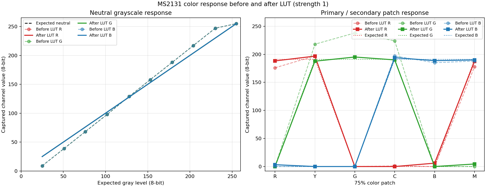

# MacroSilicon MS2131 Firmware Experiments

## 中文 Chinese

本目录记录 MS2131 采集卡的固件和图像测量实验。MS2131 与 MS2130 家族相近，但本项目针对带 HDMI 环出功能的 MS2131 板卡；不要直接刷入 MS2130 固件。

板卡正面照片（左侧为 HDMI 输入，右侧为 HDMI 环出）：


### 当前固件实验

当前实验固件从用户备份的 `ZMT02_MS2131_VER1.0_25082718_2541_SPI5E3213_ZB25WD40_stock.bin` 派生，将代码文件偏移 `0xB3AA` 的 `0x7A` 改成 `0x00` 并重算校验值，目标是减轻过度锐化。候选文件位于项目根目录：

`ZMT02_MS2131_VER1.0_25082718_2541_SPI5E3213_ZB25WD40_deblur_candidate.bin`

实测使用 1920×1080、YUY2、60 fps。候选固件的斜边 10–90% 宽度约为 2.67 px，原固件基线约为 2.26 px；较宽的过渡表示锐化减弱。测量包含显卡输出、采集卡和 UVC 转换，不是芯片单体的实验室测量。

刷写前请保留原始 SPI 备份，并确认板卡型号、闪存型号和恢复方式。刷写由使用者通过兼容的 ms-tools 完成；本项目的测量脚本不会写入或修改固件。

### 测量与对比图

夜间模式关闭后的最新测量记录为 `../pics/ms2131_nightlight_off_measurements.json`，对比图为 `../pics/ms2131_sharpness_color_comparison.png`。夜间模式开启时的旧抓图和报告已移至 `../pics/nightlight_on_archive/`；请勿用旧色彩数据判断当前表现。

### 锐度可视化与测量参数

下图左侧对比斜边响应，曲线越宽表示边缘过渡越缓；右侧显示夜间模式关闭后的灰阶 RGB 响应。


- 输入：1920×1080、YUY2、60 fps；斜边图在 1920×1080 下全屏显示。
- 亮度：按 `Y = 0.299R + 0.587G + 0.114B` 计算，并对斜边 ROI 内 710 行取平均。
- 斜边 ROI：`y = 220…929`；边缘中心 `x = 350 + 0.045 × (y − 555)`；每行取中心左右各 20 px。
- 白/黑平台：边缘中心偏移 `−20…−10 px` 与 `+10…+20 px`；用两侧平台归一化后线性插值得到 10% 和 90% 交点，报告两者间距。
- 结果：原固件约 2.27 px，测试固件约 2.67 px，测试固件边缘更柔和。原固件抓图是在 Windows 夜间模式开启时采集；归一化斜边宽度对色调影响较小，但这并非完全同条件比较。

处理脚本会读取测试图、原固件斜边抓图、当前固件斜边抓图、当前色条抓图和采样坐标 JSON，然后更新测量 JSON 与对比图。默认输入：

- `../pics/ms2131_sharpness_test_1080p.png`
- `../pics/nightlight_on_archive/ms2131_sharpness_chart_before.png`（原固件基线；采集时 Windows 夜间模式开启）
- `../pics/ms2131_sharpness_chart_nightlight_off.png`
- `../pics/ms2131_colorbars_capture_nightlight_off.png`
- `../pics/ms2131_colorbars_1080p_samples.json`

需要 Python 3、Pillow、NumPy 和 Matplotlib。安装依赖并运行：

```powershell
py -m pip install pillow numpy matplotlib
py MS2131_\process_measurements.py
```

脚本会计算斜边 10–90% 宽度、边缘过冲/下冲和色条/灰阶 RGB 读数，并重建 `pics/ms2131_nightlight_off_measurements.json` 与 `pics/ms2131_sharpness_color_comparison.png`。颜色测量覆盖完整 HDMI 到 UVC 链路；夜间模式、显卡色彩设置、输出动态范围或颜色转换都会影响结果。

### 文件

- `../MS2131_086-1_2403_stock_255255255255.bin`：另一份旧固件备份；芯片读取时报告版本 `FFFF`，其身份和读取可靠性尚未确认。
- `../ZMT02_MS2131_VER1.0_25082718_2541_SPI5E3213_ZB25WD40_stock.bin`：当前板卡的原始固件备份。
- `../ZMT02_MS2131_VER1.0_25082718_2541_SPI5E3213_ZB25WD40_deblur_candidate.bin`：去锐化实验候选固件。
- `../MS2131_datasheet.pdf`：本地数据手册；该文件已加入 Git 忽略规则，不会被 Git 跟踪。

### 色彩校正 LUT（实验性）

色条显示绿色响应偏高，红、蓝也有较小偏差。脚本 `generate_color_lut.py` 根据本次灰阶和主/次色块测量生成主机端 3D LUT：`pics/ms2131_color_correction.cube`。左右对比预览为 `pics/ms2131_colorbars_lut_preview.png`，**应用前后的响应曲线**为 `pics/ms2131_color_lut_curves.png`，拟合数据与误差记录为 `pics/ms2131_color_lut_fit.json`。



运行：

```powershell
py generate_color_lut.py
```

LUT 先反转实测灰阶曲线，再用色块拟合一个小型颜色矩阵，并在中性色轴上逐渐减弱色度校正。可在 OBS 的 [Apply LUT 视频滤镜](https://obsproject.com/kb/apply-lut-filter) 中加载 `.cube` 文件。此校正作用于电脑上的采集画面，不会修改或刷入采集卡固件。

当前 LUT 是初步拟合：训练样本有限，且测量包含显卡 HDMI 输出、MS2131、UVC 和 RGB 转换。报告中的校正后误差是对训练色块的模型预测，不是独立复测。使用前请先在 OBS 对照色条预览；显卡范围、采集格式或软件色彩链路变化后应重新测量和生成。

## English

This directory documents firmware and image-measurement work on an MS2131 capture card. The MS2131 is related to the MS2130 family, but this project targets an MS2131 board with HDMI loop-out. Do not flash MS2130 firmware onto it.

Board front photo (HDMI input on the left, HDMI loop-out on the right):


### Current firmware experiment

The experimental firmware was derived from the user's backup, `ZMT02_MS2131_VER1.0_25082718_2541_SPI5E3213_ZB25WD40_stock.bin`. It changes code-file offset `0xB3AA` from `0x7A` to `0x00` and recalculates the checksum, with the goal of reducing excessive sharpening. The candidate file is in the project root:

`ZMT02_MS2131_VER1.0_25082718_2541_SPI5E3213_ZB25WD40_deblur_candidate.bin`

Measurements use 1920×1080, YUY2, 60 fps. The candidate firmware produced a slanted-edge 10–90% width of about 2.67 px, compared with about 2.26 px for the stock baseline. A wider transition indicates reduced sharpening. These measurements include the GPU output, capture card, and UVC conversion; they are not laboratory measurements of the chip alone.

Keep the original SPI backup and confirm the board model, flash model, and recovery method before flashing. Flashing is performed by the user with compatible ms-tools. The measurement script does not write or modify firmware.

### Measurements and comparison figure

The latest measurements, taken with Windows Night Light disabled, are in `../pics/ms2131_nightlight_off_measurements.json`; the comparison figure is `../pics/ms2131_sharpness_color_comparison.png`. Captures and reports made with Night Light enabled are archived in `../pics/nightlight_on_archive/`. Do not use those older color measurements to assess the current color response.

### Sharpness visualization and measurement parameters

The figure below compares the slanted-edge response on the left; a wider curve indicates a softer edge transition. The right panel shows grayscale RGB response with Night Light disabled.


- Capture mode: 1920×1080, YUY2, 60 fps; the edge chart was shown full-screen at 1920×1080.
- Luma: `Y = 0.299R + 0.587G + 0.114B`, averaged over 710 rows in the edge ROI.
- Slanted-edge ROI: `y = 220…929`; edge center `x = 350 + 0.045 × (y − 555)`; each row samples 20 pixels on either side of the center.
- White/black plateaus: offsets `−20…−10 px` and `+10…+20 px`. The plateaus normalize the edge response; 10% and 90% crossing positions are linearly interpolated, and their distance is reported.
- Results: about 2.27 px for stock firmware and 2.67 px for the test firmware, indicating a softer edge with the test firmware. The stock capture was made while Windows Night Light was enabled. Normalized edge width is less sensitive to this tone shift, but this is not a fully matched-condition comparison.

The processing script reads the source chart, stock and test-firmware edge captures, the current color-bar capture, and the sample-coordinate JSON. It then updates the measurement JSON and comparison figure. Default inputs:

- `../pics/ms2131_sharpness_test_1080p.png`
- `../pics/nightlight_on_archive/ms2131_sharpness_chart_before.png` (stock baseline; captured with Windows Night Light enabled)
- `../pics/ms2131_sharpness_chart_nightlight_off.png`
- `../pics/ms2131_colorbars_capture_nightlight_off.png`
- `../pics/ms2131_colorbars_1080p_samples.json`

Requirements: Python 3, Pillow, NumPy, and Matplotlib. Install dependencies and run:

```powershell
py -m pip install pillow numpy matplotlib
py MS2131_\process_measurements.py
```

The script measures slanted-edge 10–90% width, edge overshoot/undershoot, and color-bar/grayscale RGB values. It regenerates `pics/ms2131_nightlight_off_measurements.json` and `pics/ms2131_sharpness_color_comparison.png`. Color measurements cover the entire HDMI-to-UVC path; Night Light, GPU color settings, output range, and color conversion can affect the results.

### Files

- `../MS2131_086-1_2403_stock_255255255255.bin`: an older firmware backup. The chip-reading tool reported version `FFFF`; its identity and read reliability have not been confirmed.
- `../ZMT02_MS2131_VER1.0_25082718_2541_SPI5E3213_ZB25WD40_stock.bin`: stock firmware backup from the current board.
- `../ZMT02_MS2131_VER1.0_25082718_2541_SPI5E3213_ZB25WD40_deblur_candidate.bin`: experimental de-sharpening firmware candidate.
- `../MS2131_datasheet.pdf`: local datasheet. It is excluded from Git by the ignore rule.

### Experimental color-correction LUT

The color bars show an elevated green response with smaller red and blue deviations. `generate_color_lut.py` uses the measured grayscale ramp and primary/secondary patches to generate a host-side 3D LUT at `pics/ms2131_color_correction.cube`. The side-by-side preview is `pics/ms2131_colorbars_lut_preview.png`; **the before/after response curves** are in `pics/ms2131_color_lut_curves.png`; the fit and error report is `pics/ms2131_color_lut_fit.json`.


Run:

```powershell
py generate_color_lut.py
```

The LUT first inverts the measured grayscale response, then applies a small color matrix fitted to the color patches, with chroma correction tapered toward the neutral axis. Load the `.cube` file with OBS's [Apply LUT video filter](https://obsproject.com/kb/apply-lut-filter). This corrects the captured image on the computer; it does not modify or flash the capture-card firmware.

This is a preliminary fit from a limited set of patches. Measurements include the GPU HDMI output, MS2131, UVC, and RGB conversion. The reported post-correction error is a model prediction on the training patches, not an independent recapture. Check it against a color chart in OBS before use; changes to GPU range, capture format, or software color pipeline require new measurements and a new LUT.
