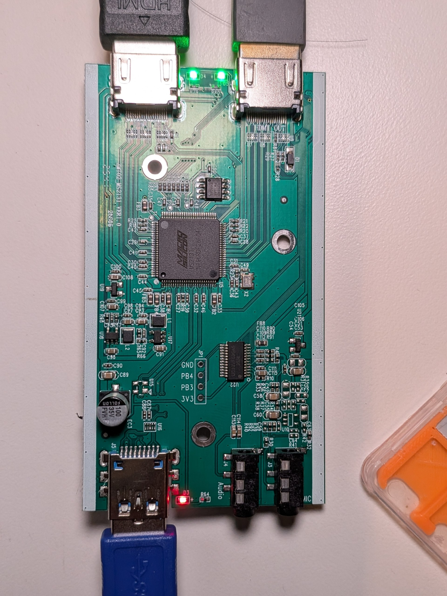
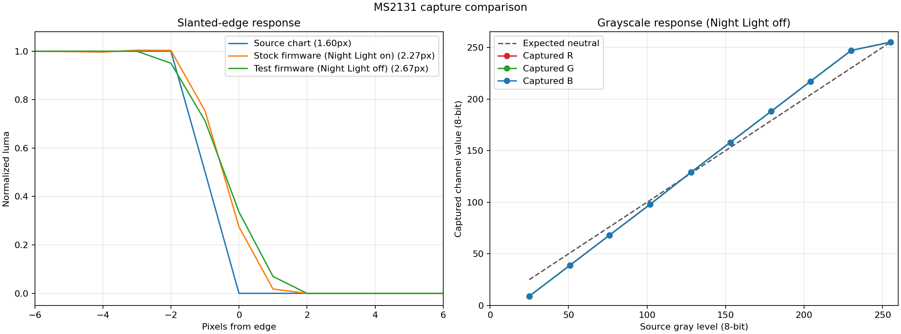

# MacroSilicon MS2131 Firmware Experiments

## 中文 Chinese

本目录记录 MS2131 采集卡的固件和图像测量实验。

本项目参考MS2130项目，为MS2131环出版本加入了去锐化固件与LUT色彩校正功能。  


板卡正面照片（左侧为 HDMI 输入，右侧为 HDMI 环出）：



### 当前固件实验

当前实验固件从用户备份的 `ZMT02_MS2131_VER1.0_25082718_2541_SPI5E3213_ZB25WD40_stock.bin` 派生，将代码文件偏移 `0xB3AA` 的 `0x7A` 改成 `0x00` 并重算校验值，目标是减轻过度锐化。候选文件位于项目根目录：

`ZMT02_MS2131_VER1.0_25082718_2541_SPI5E3213_ZB25WD40_deblur_candidate.bin`

实测使用 1920×1080、YUY2、60 fps。候选固件的斜边 10–90% 宽度约为 2.67 px，原固件基线约为 2.26 px；较宽的过渡表示锐化减弱。测量包含显卡输出、采集卡和 UVC 转换，不是芯片单体的实验室测量。

刷写前请保留原始 SPI 备份，并确认板卡型号、闪存型号和恢复方式。刷写由使用者通过兼容的 ms-tools 完成；本项目的测量脚本不会写入或修改固件。

### 测量与对比图

夜间模式关闭后的最新测量记录为 `../pics/ms2131_nightlight_off_measurements.json`，对比图为 `../pics/ms2131_sharpness_color_comparison.png`。夜间模式开启时的旧抓图和报告已移至 `../pics/nightlight_on_archive/`；请勿用旧色彩数据判断当前表现。

### 锐度可视化与测量参数

下图左侧对比斜边响应，曲线越宽表示边缘过渡越缓；右侧显示夜间模式关闭后的灰阶 RGB 响应。



- 输入：1920×1080、YUY2、60 fps；斜边图在 1920×1080 下全屏显示。
- 亮度：按 `Y = 0.299R + 0.587G + 0.114B` 计算，并对斜边 ROI 内 710 行取平均。
- 斜边 ROI：`y = 220…929`；边缘中心 `x = 350 + 0.045 × (y − 555)`；每行取中心左右各 20 px。
- 白/黑平台：边缘中心偏移 `−20…−10 px` 与 `+10…+20 px`；用两侧平台归一化后线性插值得到 10% 和 90% 交点，报告两者间距。
- 结果：原固件约 2.27 px，测试固件约 2.67 px，测试固件边缘更柔和。原固件抓图是在 Windows 夜间模式开启时采集；归一化斜边宽度对色调影响较小，但这并非完全同条件比较。

处理脚本会读取测试图、原固件斜边抓图、当前固件斜边抓图、当前色条抓图和采样坐标 JSON，然后更新测量 JSON 与对比图。默认输入：

- `../pics/ms2131_sharpness_test_1080p.png`
- `../pics/nightlight_on_archive/ms2131_sharpness_chart_before.png`（原固件基线；采集时 Windows 夜间模式开启）
- `../pics/ms2131_sharpness_chart_nightlight_off.png`
- `../pics/ms2131_colorbars_capture_nightlight_off.png`
- `../pics/ms2131_colorbars_1080p_samples.json`

需要 Python 3、Pillow、NumPy 和 Matplotlib。安装依赖并运行：

```powershell
py -m pip install pillow numpy matplotlib
py MS2131_\process_measurements.py
```

脚本会计算斜边 10–90% 宽度、边缘过冲/下冲和色条/灰阶 RGB 读数，并重建 `pics/ms2131_nightlight_off_measurements.json` 与 `pics/ms2131_sharpness_color_comparison.png`。颜色测量覆盖完整 HDMI 到 UVC 链路；夜间模式、显卡色彩设置、输出动态范围或颜色转换都会影响结果。

### 文件

- `../MS2131_086-1_2403_stock_255255255255.bin`：另一份旧固件备份；芯片读取时报告版本 `FFFF`，其身份和读取可靠性尚未确认。
- `../ZMT02_MS2131_VER1.0_25082718_2541_SPI5E3213_ZB25WD40_stock.bin`：当前板卡的原始固件备份。
- `../ZMT02_MS2131_VER1.0_25082718_2541_SPI5E3213_ZB25WD40_deblur_candidate.bin`：去锐化实验候选固件。
- `../MS2131_datasheet.pdf`：本地数据手册；该文件已加入 Git 忽略规则，不会被 Git 跟踪。

### 色彩校正 LUT（实验性）

`generate_color_lut.py` 现在从显示器和采集卡实时测量，不再读取仓库里预先保存的测量文档。脚本先列出 DirectShow/UVC 视频设备、Alternative Name 和 USB VID/PID，并标出最可能的采集卡候选供命令行选择；随后在每台显示器左上角短暂显示不同编号/颜色，并读取一帧采集信号来识别匹配的屏幕。最后列出显示器分辨率并推荐与采集模式吻合的项，供命令行确认。校准阶段会在所选屏幕全屏显示灰阶、RGB 色块和斜边图案，并直接从所选采集设备抓帧。如果设备被 OBS 等程序占用，脚本会提示释放设备后重试。

显示器列表同时记录 Windows 的 **Active signal mode（活动信号模式）**，即显卡实际输出给显示器的有效分辨率和刷新率；它与桌面坐标区域分开保存，用于检查 GPU 缩放等情况。新校准结果会把该值保存在 `tmp/calibration_data.json` 的 `monitor.active_signal_mode` 中。早先生成的 JSON 没有保存这个字段，无法从旧抓帧可靠还原。

运行：

```powershell
py generate_color_lut.py
```

需要 Windows、numpy、Tkinter 和带 DirectShow 支持的 FFmpeg。开始前关闭 Windows 夜间模式/HDR 和显卡视频增强，保持显示器原生分辨率、1:1 缩放及固定采集格式/范围。若 DirectShow 报告无法打开采集流，请关闭 OBS、浏览器或相机应用中占用该采集卡的来源后重试。脚本在当前目录创建 `tmp`，保存测试图、LUT 前采集帧、LUT 后软件预测预览、左右对照图、逐色块数据、边缘响应指标及 `.cube` LUT。可在 OBS 的 [Apply LUT 视频滤镜](https://obsproject.com/kb/apply-lut-filter) 中加载 LUT；它不会修改或刷入采集卡固件。

“LUT 后”图像和误差是对同一采集帧应用 LUT 的软件预测，不是二次硬件采集。LUT 只能校正色调与颜色，不能恢复采集链路已经丢失的空间细节；斜边指标会单独显示这类锐度变化。想得到最接近 HDMI 源图的结果，应先用原版固件和固定的显示/采集设置建立基线，再只修正实测到的误差。

### MS2131 固件补丁脚本

根目录的 `ms2131_patch.c` 和 `patch_ms2131.py` 是本项目自己的 MS2131 补丁器，与 `MS2130_` 下 fork 的 MS2130 源码分开。它们针对当前已验证的 512 KiB SPI 备份，只改文件偏移 `0xB3AA`（`0x7A → 0x00`），重算代码校验和，并输出到独立文件；不会写入采集卡。

Python 版本会校验原始固件 SHA-256、镜像长度、头部/代码校验和及补丁原字节；C 版本会校验镜像大小、长度、头部/代码校验和及补丁原字节。两者都拒绝将输出写回输入。Python 默认拒绝覆盖现有候选文件；确认要重建时加 `--force`：

```powershell
py patch_ms2131.py
py patch_ms2131.py --force
```

C 版本用 C99 编译；若输出文件已存在，同样需明确传入 `--force`：

```powershell
gcc -O2 -Wall -Wextra -o ms2131_patch.exe ms2131_patch.c
.\ms2131_patch.exe
.\ms2131_patch.exe --force
```

这些脚本只适用于该确切固件版本，不是通用 MS2131/MS2130 转换工具。请保留原始备份，并在自行刷写前确认可恢复方式。

### 固件文件识别器

`identify_ms21xx.py` 使用固件头、加法校验和，以及 `0xB3AA`、MS2130 补丁点等特定文件偏移的字节特征识别仓库中的样本；模式支持 `??` 单字节通配符。未知文件只会依据有效固件头、代码长度和校验和给出“疑似”布局判断。它只读取固件文件，不访问 USB 设备，也不会刷写。

```powershell
py identify_ms21xx.py .\binary\ZMT02_MS2131_VER1.0_25082718_2541_SPI5E3213_ZB25WD40_stock.bin
py identify_ms21xx.py .\binary\MS2131_086-1_2403_stock_255255255255.bin --json
py identify_ms21xx.py .\binary\goodZB25WD40@SOIC8.BIN
py identify_ms21xx.py .\binary\crapZB25WD40@SOIC8.BIN
py identify_ms21xx.py .\MS2130_\4k2.bin
```

特征字节匹配用于识别已知固件构建。结构特征只能用于推测固件家族，不能单凭固件文件证明板上芯片型号；未知版本会明确标为“疑似”或“无法识别”。

识别器也扫描 8051 指令形式 `90 addr_hi addr_lo 74 value F0`（`MOV DPTR,#addr; MOV A,#value; MOVX @DPTR,A`），并报告直接寄存器写入。对当前样本，它能找到 `F6B4` 写入：MS2130、good/crap 和 ZMT02 原版写 `0x7A`，去锐化候选写 `0x00`。`hsdaoh` 没有说明 `F6B4` 的语义；结合本项目 A/B 采集测量，脚本把它标成“可能与锐化有关的参数”，属于推断，不能当成正式寄存器定义。

`hsdaoh` 在 [MS2130 transparent-mode 源码](https://github.com/steve-m/hsdaoh/blob/master/src/libhsdaoh.c#L2496-L2537) 中记录了一组实验性设置：`F6B0=00` 关闭锐化、`F6BE=11` 关闭亮度处理、`F6BF=11` 关闭色度处理、`F65C/F65E=10` 关闭水平/垂直缩放、`F600=80` 关闭色度插值；`F039/F030` 用于选择 YCbCr 4:2:2/YUV 输入。识别器会在 JSON 中附上这组参考，并在确认为 MS2130 补丁版时输出相应功能说明。源码作者说明这些值来自试错观察，且不保证；寄存器参考并不自动证明 MS2131 上的同名寄存器具有完全相同的作用。

对于 MS2130 补丁版，识别结果还会解读掩码涉及的位：`F6B0` 清 bit 0，`F6BE/F6BF` 置 bit 0 和 bit 4，`F600` 置 bit 7。缩放相关代码是改写调用/参数，不是单纯的寄存器位掩码。MS2131 目前只报告固件中直接定位到的 `F6B4` 值；该地址在 `hsdaoh` 中没有功能定义。


## English

This directory documents firmware and image-measurement work on an MS2131 capture card. 

This project is based on MS2130 disable sharpening project, added support for MS2131 and add a color correction LUT script.

Board front photo (HDMI input on the left, HDMI loop-out on the right):


### Current firmware experiment

The experimental firmware was derived from the user's backup, `ZMT02_MS2131_VER1.0_25082718_2541_SPI5E3213_ZB25WD40_stock.bin`. It changes code-file offset `0xB3AA` from `0x7A` to `0x00` and recalculates the checksum, with the goal of reducing excessive sharpening. The candidate file is in the project root:

`ZMT02_MS2131_VER1.0_25082718_2541_SPI5E3213_ZB25WD40_deblur_candidate.bin`

Measurements use 1920×1080, YUY2, 60 fps. The candidate firmware produced a slanted-edge 10–90% width of about 2.67 px, compared with about 2.26 px for the stock baseline. A wider transition indicates reduced sharpening. These measurements include the GPU output, capture card, and UVC conversion; they are not laboratory measurements of the chip alone.

Keep the original SPI backup and confirm the board model, flash model, and recovery method before flashing. Flashing is performed by the user with compatible ms-tools. The measurement script does not write or modify firmware.

### Measurements and comparison figure

The latest measurements, taken with Windows Night Light disabled, are in `../pics/ms2131_nightlight_off_measurements.json`; the comparison figure is `../pics/ms2131_sharpness_color_comparison.png`. Captures and reports made with Night Light enabled are archived in `../pics/nightlight_on_archive/`. Do not use those older color measurements to assess the current color response.

### Sharpness visualization and measurement parameters

The figure below compares the slanted-edge response on the left; a wider curve indicates a softer edge transition. The right panel shows grayscale RGB response with Night Light disabled.


- Capture mode: 1920×1080, YUY2, 60 fps; the edge chart was shown full-screen at 1920×1080.
- Luma: `Y = 0.299R + 0.587G + 0.114B`, averaged over 710 rows in the edge ROI.
- Slanted-edge ROI: `y = 220…929`; edge center `x = 350 + 0.045 × (y − 555)`; each row samples 20 pixels on either side of the center.
- White/black plateaus: offsets `−20…−10 px` and `+10…+20 px`. The plateaus normalize the edge response; 10% and 90% crossing positions are linearly interpolated, and their distance is reported.
- Results: about 2.27 px for stock firmware and 2.67 px for the test firmware, indicating a softer edge with the test firmware. The stock capture was made while Windows Night Light was enabled. Normalized edge width is less sensitive to this tone shift, but this is not a fully matched-condition comparison.

The processing script reads the source chart, stock and test-firmware edge captures, the current color-bar capture, and the sample-coordinate JSON. It then updates the measurement JSON and comparison figure. Default inputs:

- `../pics/ms2131_sharpness_test_1080p.png`
- `../pics/nightlight_on_archive/ms2131_sharpness_chart_before.png` (stock baseline; captured with Windows Night Light enabled)
- `../pics/ms2131_sharpness_chart_nightlight_off.png`
- `../pics/ms2131_colorbars_capture_nightlight_off.png`
- `../pics/ms2131_colorbars_1080p_samples.json`

Requirements: Python 3, Pillow, NumPy, and Matplotlib. Install dependencies and run:

```powershell
py -m pip install pillow numpy matplotlib
py MS2131_\process_measurements.py
```

The script measures slanted-edge 10–90% width, edge overshoot/undershoot, and color-bar/grayscale RGB values. It regenerates `pics/ms2131_nightlight_off_measurements.json` and `pics/ms2131_sharpness_color_comparison.png`. Color measurements cover the entire HDMI-to-UVC path; Night Light, GPU color settings, output range, and color conversion can affect the results.

### Files

- `../MS2131_086-1_2403_stock_255255255255.bin`: an older firmware backup. The chip-reading tool reported version `FFFF`; its identity and read reliability have not been confirmed.
- `../ZMT02_MS2131_VER1.0_25082718_2541_SPI5E3213_ZB25WD40_stock.bin`: stock firmware backup from the current board.
- `../ZMT02_MS2131_VER1.0_25082718_2541_SPI5E3213_ZB25WD40_deblur_candidate.bin`: experimental de-sharpening firmware candidate.
- `../MS2131_datasheet.pdf`: local datasheet. It is excluded from Git by the ignore rule.

### Experimental color-correction LUT

`generate_color_lut.py` now measures the live display/capture path instead of reading a saved measurement document. It first lists DirectShow/UVC video devices with their alternative names and USB VID/PID, marking the most likely capture-card candidate for command-line selection. It then briefly displays a unique numbered/color-coded corner marker on each monitor and samples one capture frame to identify the matching screen. It lists display resolutions and recommends the one matching the capture mode for command-line confirmation. The calibration stage displays a full-screen grayscale/RGB/edge chart on the selected monitor and captures directly from the selected device. If another app such as OBS holds the device, it prompts for a retry after releasing it.

The display list also records Windows **Active signal mode**: the effective resolution and refresh rate the GPU sends to the display. It is stored separately from the desktop bounds to help identify GPU scaling. New calibration reports save it as `monitor.active_signal_mode` in `tmp/calibration_data.json`. Earlier JSON reports do not contain this field, and it cannot be reliably reconstructed from their saved captures.

Run from the repository directory:

```powershell
py generate_color_lut.py
```

Requirements: Windows, numpy, Tkinter, and FFmpeg built with DirectShow support. Disable Windows Night Light/HDR and GPU video enhancements, and keep native display resolution, 1:1 scaling, and capture format/range fixed. If DirectShow cannot open the capture stream, close the capture source in OBS, a browser, or the Camera app and retry. The script creates `tmp` in the current directory and saves the source chart, pre-LUT capture, predicted post-LUT preview, side-by-side comparison, per-patch measurement data, edge-response metrics, and `.cube` LUT. Load the LUT with OBS's [Apply LUT video filter](https://obsproject.com/kb/apply-lut-filter); the script does not change or flash firmware.

Post-LUT images and errors are software predictions from the same captured frame, not a second hardware capture. A LUT can correct tone and color, but cannot restore spatial detail lost in the capture path; the script reports edge-response metrics separately. For the closest match to the HDMI source, first establish a baseline using stock firmware and fixed display/capture settings, then correct only measured errors.

### MS2131 firmware patch scripts

The root-level `ms2131_patch.c` and `patch_ms2131.py` are this project's MS2131 patchers, kept separate from the forked MS2130 sources under `MS2130_`. They target only the verified 512 KiB SPI backup. The scripts change file offset `0xB3AA` (`0x7A → 0x00`), recalculate the code checksum, and write a separate output file; they do not flash the capture card.

The Python version verifies the source firmware SHA-256, image size, header/code checksums, and original patch byte. The C version verifies the image size, code length, header/code checksums, and original patch byte. Both refuse to write over the input. Python refuses to overwrite an existing candidate unless `--force` is supplied:

```powershell
py patch_ms2131.py
py patch_ms2131.py --force
```

Compile the C version as C99. If the output exists, explicitly pass `--force`:

```powershell
gcc -O2 -Wall -Wextra -o ms2131_patch.exe ms2131_patch.c
.\ms2131_patch.exe
.\ms2131_patch.exe --force
```

These scripts are specific to this exact firmware version; they are not general MS2131/MS2130 conversion tools. Keep the original backup and confirm a recovery method before flashing firmware manually.

### Firmware file identifier

`identify_ms21xx.py` identifies repository samples using firmware headers, additive checksums, and byte signatures at specific file offsets such as `0xB3AA` and the MS2130 patch sites. Patterns support `??` as a one-byte wildcard. Unknown files are only reported as a *likely* layout when their header, code length, and checksums fit. The script only reads firmware files; it does not access a USB device or flash firmware.

```powershell
py identify_ms21xx.py .\binary\ZMT02_MS2131_VER1.0_25082718_2541_SPI5E3213_ZB25WD40_stock.bin
py identify_ms21xx.py .\binary\MS2131_086-1_2403_stock_255255255255.bin --json
py identify_ms21xx.py .\binary\goodZB25WD40@SOIC8.BIN
py identify_ms21xx.py .\binary\crapZB25WD40@SOIC8.BIN
py identify_ms21xx.py .\MS2130_\4k2.bin
```

Byte-signature matches identify the known firmware builds. Structural matches are only family-layout heuristics and cannot by themselves prove the physical chip fitted to a board. Unknown builds are reported as likely or unidentified rather than as a confirmed chip identity.

The identifier also scans for the 8051 instruction pattern `90 addr_hi addr_lo 74 value F0` (`MOV DPTR,#addr; MOV A,#value; MOVX @DPTR,A`) and reports direct register writes. In the current samples it finds writes to `F6B4`: `0x7A` in MS2130, good/crap, and ZMT02 stock images, and `0x00` in the de-sharpening candidate. `hsdaoh` does not define `F6B4`; based on this project's A/B capture measurements, the script labels it a *likely sharpening-related parameter*. This is an inference, not a published register definition.

`hsdaoh` records an experimental setting list in its [MS2130 transparent-mode source](https://github.com/steve-m/hsdaoh/blob/master/src/libhsdaoh.c#L2496-L2537): `F6B0=00` to disable sharpening, `F6BE=11` to disable luma processing, `F6BF=11` to disable chroma processing, `F65C/F65E=10` to disable horizontal/vertical scaling, and `F600=80` to disable chroma interpolation; `F039/F030` select YCbCr 4:2:2/YUV input. The identifier includes these references in JSON and reports the associated feature intent for the recognized MS2130 patched image. The source author says the values were found by trial and error and gives no warranty; matching register addresses do not establish that MS2131 behaves identically.

For the recognized MS2130 patch image, the output also identifies mask bits: bit 0 is cleared in `F6B0`, bits 0 and 4 are set in `F6BE/F6BF`, and bit 7 is set in `F600`. The scaling changes patch call/parameter behavior rather than a simple register mask. For MS2131, the script currently reports only the directly located `F6B4` value; `hsdaoh` does not define that register's function.
